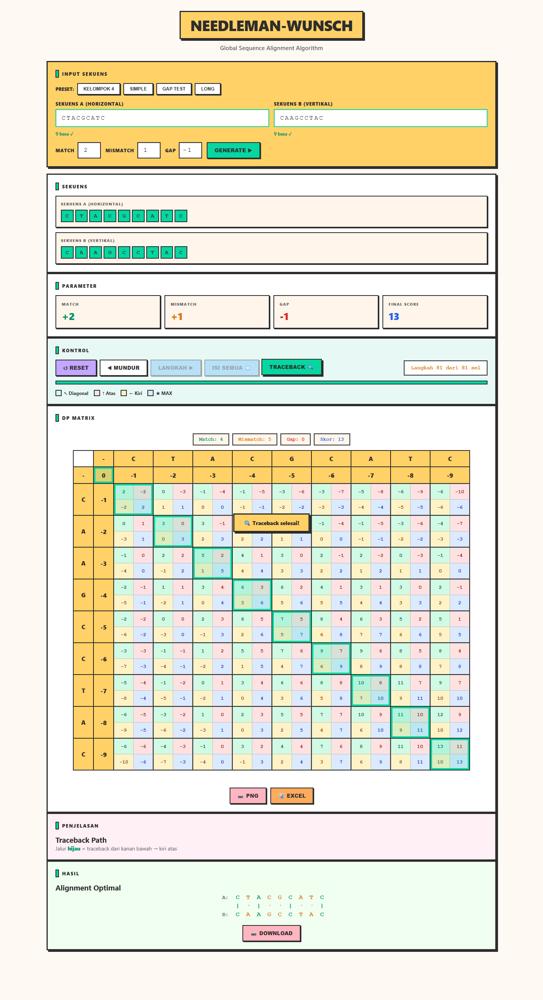

<div align="center">

# Needleman-Wunsch Algorithm

**Visualisasi Interaktif Global Sequence Alignment**



[](https://needleman-neobrutalism.vercel.app/)
[](/)
[](/)
[](/)

</div>

---

## 📖 Tentang

Aplikasi web interaktif untuk memvisualisasikan **Needleman-Wunsch Algorithm** — algoritma dynamic programming untuk global sequence alignment. Cocok untuk pembelajaran bioinformatika dan memahami cara kerja alignment DNA/protein sequences.

## ✨ Fitur

- 🎯 **Step-by-step visualization** — Lihat proses pengisian matriks sel per sel
- ⏩ **Isi semua sekaligus** — Skip ke hasil akhir dengan satu klik
- 🔍 **Traceback path** — Visualisasi jalur optimal dengan highlight hijau
- 📊 **Export ke Excel/CSV** — Download matriks untuk analisis lebih lanjut
- 📷 **Export ke PNG** — Screenshot matriks dan hasil alignment
- 🎨 **Neobrutalism UI** — Desain modern, soft colors, enak di mata
- 📱 **Responsive** — Works on desktop & mobile

## 🚀 Demo

**Live:** [needleman-neobrutalism.vercel.app](https://needleman-neobrutalism.vercel.app/)

### Preset Sequences

| Preset | Sekuens A | Sekuens B | Match | Mismatch | Gap |
|--------|-----------|-----------|-------|----------|-----|
| Kelompok 4 | CTACGCATC | CAAGCCTAC | +2 | +1 | -1 |
| Simple | ACGT | AGT | +2 | -1 | -2 |
| Gap Test | AGTACG | ACATAG | +2 | +1 | -1 |
| Long | ATCGATCGATCG | ATGCATGCATGC | +1 | -1 | -2 |

## 🛠️ Cara Pakai

1. **Input sekuens** — Masukkan sekuens A dan B (max 15 karakter, huruf A/C/G/T/N)
2. **Set parameter** — Atur nilai Match, Mismatch, dan Gap
3. **Generate** — Klik tombol Generate untuk membuat matriks
4. **Visualisasi** — Gunakan tombol kontrol:
   - `Langkah ▶` — Isi sel satu per satu
   - `Isi Semua ⏩` — Isi semua sel sekaligus
   - `Traceback 🔍` — Tampilkan jalur optimal
5. **Export** — Download hasil sebagai PNG atau CSV

## 📁 Struktur Project

```
needleman-wunsch-algorithm/
├── index.html      # Single-file app (HTML + CSS + JS)
├── docs/
│   └── preview.png # Screenshot untuk README
├── README.md
└── LICENSE
```

## 🧬 Algoritma

Needleman-Wunsch menggunakan **dynamic programming** untuk mencari alignment optimal antara dua sekuens:

1. **Inisialisasi** — Baris & kolom pertama diisi dengan kelipatan gap penalty
2. **Pengisian Matriks** — Setiap sel dihitung dari 3 arah:
   - ↖ Diagonal: `M[i-1][j-1] + match/mismatch`
   - ↑ Atas: `M[i-1][j] + gap`
   - ← Kiri: `M[i][j-1] + gap`
   - Ambil nilai **maksimum**
3. **Traceback** — Mulai dari kanan bawah, ikuti jalur optimal ke kiri atas

## 👥 Tim Pengembang

**Kelompok 4 — Sistem Cerdas**

| Nama | NIM |
|------|-----|
| Muhammad Izzuddin Syarofil Adzkia | 2802521213 |
| Melvyn Novsallen Lase | 2802528876 |
| Rizky Putra Ichfiandra | 2802530331 |
| Muhammad Raid Zakwan | 2802532684 |

## 📄 Lisensi

[MIT License](LICENSE) — Bebas digunakan untuk pembelajaran dan pengembangan.

---

<div align="center">

Made with ❤️ for Bioinformatics Education

</div>
